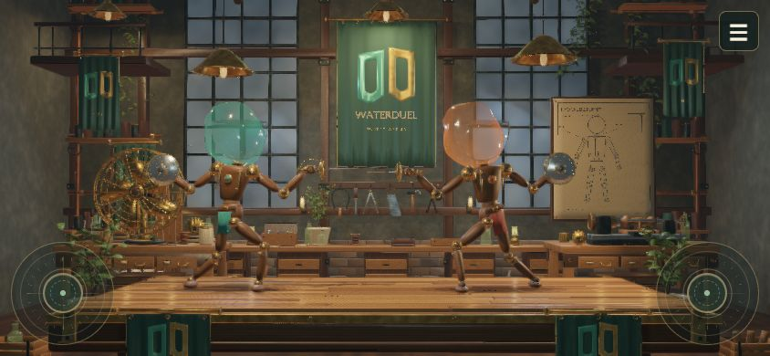

# WaterDuel · Puppet Arena · offline LAN

**[Jugar en GitHub Pages](https://gatdeguin.github.io/WaterDuel/)** · Abrí el enlace en el teléfono y giralo a horizontal.

Pages publica la experiencia individual con los dos joysticks y el menú ☰. Para jugar de a dos con móviles en la misma Wi-Fi, usá el servidor LAN descrito abajo. Los cambios en `main` se prueban y despliegan automáticamente; [configuración del despliegue](docs/GITHUB_PAGES.md).

## Música 1.7.1 · Roda de muñecos

La banda sonora toma la dirección de capoeira de muñecos: cuerda pulsada resonante, tamborcito, sonajas y percusión sincopada de madera y latón, con frases de pregunta y respuesta. Conserva los cuatro modos según el combate, las transiciones y el espacio para el foley. Los doce stems se preparan como WAV locales; la música del navegador no se sintetiza durante el combate. [Escuchar muestra](public/assets/audio/workshop-roda-v4/listening-montage.wav) · [composición y verificación](docs/MUSICA_RODA.md).

## Versión 1.7.0

La selección de 22 mejoras incorpora hojas elásticas con la misma curva visual y física, reajuste del agarre, manos adaptadas a cada empuñadura y holgura progresiva en articulaciones. La IA distingue amenazas visibles y recordadas y adapta sus decisiones al equipo rival. El menú móvil añade **Parada y contraataque**, **Blancos móviles** y **Esquiva en profundidad**, con progreso obtenido mediante contactos, esquivas y pinchazos físicos.

Se añaden emblemas compartidos por globo, falda y mando, arañazos desde contactos reales, lubricación localizada, tela mojada por parcelas de agua, aire localizado del ventilador y sombras de contacto. El látex propaga desgarros con un presupuesto de energía; el agua incorpora contacto capilar reducido y absorción que excluye los huecos entre componentes separados cuando la GPU admite mezcla flotante.

La preparación del renderer precede al inicio y reutiliza buffers. El menú móvil muestra métricas separadas para juego estable, choques, desprendimientos y ruptura. Se conserva toda la geometría, materiales y funciones; los assets actuales ya estaban agrupados, por lo que el agrupador adicional no acredita un ahorro en ellos. **60 FPS sostenidos siguen pendientes**: las capturas iniciales muestran mayor coste CPU en desprendimientos y ruptura, sin una mejora global acreditada. El navegador integrado limita además sus callbacks a aproximadamente 1 Hz e impide certificar la cadencia de pantalla. [Alcance, validación y límites de las 22 mejoras](docs/MEJORAS_1.7.md).

## Versión móvil 1.6.0

Abrí **`/mobile.html`** desde un servidor web y girá el teléfono a horizontal. El juego se ejecuta en ese dispositivo: joystick izquierdo para distancia, agacharse y finta; derecho para orientar, atacar y parar al llevarlo hacia atrás. Ambos mandos son semitransparentes y quedan en las esquinas inferiores. El botón **☰** abre las opciones y pausa la partida local; Comenzar vuelve directamente al juego.



Incluye duelo contra IA, escuela, práctica, precisión, campaña, equipo, audio, repeticiones y esquiva por inclinación o mando táctil opcional. No necesita el relay WebSocket ni una PC que simule la partida. Los modelos y el código deben servirse por HTTP/HTTPS: abrir el HTML como archivo local o verlo en la página de código de GitHub no inicia el juego. Las rutas de recursos admiten alojamiento en una subcarpeta.

La entrada principal detecta el control táctil y abre esta vista; `/?view=desktop` conserva la arena LAN de PC con sus dos QR y mandos separados. Para iniciar el servidor local usá `npm start` o el lanzador de tu plataforma. [Uso y controles móviles](docs/MOBILE.md).

## Desarrollo 1.5.2

El choque de armas incorpora fricción acotada y deslizamiento según presión, velocidad y masa articulada, permitiendo disputar la línea de ataque sin pegar las hojas. El movimiento lateral frena y cambia de dirección con más respuesta; se mantienen el agachado y la finta en profundidad. La rotura añade órbita y dolly con regreso a la cámara de combate. El móvil distingue articulación, desprendimiento y globo con vibraciones que no se interrumpen por choques menores.

El joystick derecho hacia atrás (izquierda del pad para ambos jugadores) recoge el arma y prepara una parada con la hoja principal. Las diagonales ajustan su altura y permiten escapar por debajo de un mazo. La desviación depende del contacto, la masa y los límites reales del brazo; el gesto puede fallar. Los recorridos cortos muestran **RECOGIENDO** y el gesto sostenido muestra **PARADA**. Soltar vuelve al neutro; derecha conserva la extensión y el ataque por perforación física.

La música local incorpora cuerdas y nuevas frases del taller. El foley usa posiciones XYZ, HRTF, oyente siguiendo la cámara y reflexiones tempranas compartidas, con alternativas estéreo/mono. La matriz de normales procedural reduce un 66,8 % el coste de ese constructor aislado conservando sus bytes; dos candidatos de agua/rig que no demostraron mejora consistente se retiraron. **60 FPS sostenidos siguen pendientes**. Ver [cambios y alcance de validación](docs/CHANGELOG_1.5.2.md).

La suite general con la parada aprobó **1.017/1.017 pruebas en 133 archivos**, sin omisiones y con fuentes estables; [recibo](audit/corte-1.5.2-parada-manual-01/receipt.json). Después se reforzaron los casos de parada con gestos móviles entregables: **12/12** en un cierre independiente, comprobando que todo el producto y las otras pruebas permanecen idénticos al corte completo. [Cierre compuesto y alcance](audit/cierre-parada-manual-1.5.2-02/receipt.json) · [evidencia física](audit/manual-weapon-parry-1.5.2/RESULTADO.md). Música de muestra: [montaje local](public/assets/audio/workshop-score-v3/listening-montage.wav). No se generó un ZIP nuevo.

El código final aprobó seis comparaciones visuales sin diferencias de píxeles. La serie de rendimiento no completó la referencia, por lo que no mide una mejora global ni certifica 60 FPS. [Evidencia de navegador](audit/water-matrices-1.5.2-browser/RESULTADO.md). Servidor y pestaña temporales cerrados.

## Corte anterior 1.5.1

El agua contenida transforma una sola vez los vértices y normales repetidos de su plantilla y reconstruye los mismos arrays originales. El tramo sostenido de CPU baja un 61,88 % en la prueba aislada, con un primer uso más costoso. Las matrices de piezas separadas se reutilizan entre copias equivalentes de pose, manteniendo independientes física, interpolación y replay; ese tramo baja un 76,7–79,0 %, unos 0,065 ms por vista de un fragmento en la fixture.

No cambian la resolución, los triángulos, las partículas, la física, los efectos ni el control móvil. La caché GPU experimental se retiró al no demostrar una mejora integrada. La última captura del código final se abortó en la referencia antes de medir el candidato; **60 FPS sostenidos siguen pendientes**. Ver [cambios, recibos y límites](docs/CHANGELOG_1.5.1.md).

Suite completa: **971/971 pruebas en 123 archivos**, sin omisiones y fuentes estables; [recibo](audit/corte-1.5.1-superficies-matrices-01/receipt.json). Servidor y pestañas temporales cerrados. No se generó un ZIP nuevo.

## Desarrollo 1.5.0

Los impactos desgastan hombros, codos, muñeca, caderas y rodillas. Las uniones pierden fuerza y pueden separarse: las piezas conservan su geometría, caen con física y dejan de transmitir fuerza al cuerpo. La espada caída conserva su punta física; la victoria sigue requiriendo perforar el globo. Cada ronda restaura el muñeco. Se añaden fisuras, astillas, crujidos y vibración en el mando de la víctima. Ver [articulaciones y alcance físico](docs/CHANGELOG_1.5.0.md).

El perfil de CPU de los tirones incluye contactos y rotura en un agregado mixto; las capturas de navegador quedaron incompletas. Dos candidatos de optimización se descartaron por falta de mejora consistente. No se certifican 60 FPS. La calidad fija sigue siendo la predeterminada. Ver [mediciones y próximos costes a investigar](docs/PERFORMANCE_SPIKES_1.5.md).

Suite completa del corte: **960/960 pruebas**, 120 archivos, sin omisiones y fuentes estables; [recibo de verificación](audit/corte-1.5-articulaciones-02/receipt.json). La escena real de QA cargó los 11 assets y mostró brazo, arma y escudo desprendidos sin errores del fixture. Los servidores temporales quedaron cerrados.

## Corte anterior 1.4.4

El lanzador de Windows valida Node.js 20+, reutiliza certificados TLS vigentes sin exigir PowerShell y distingue errores de permisos, certificados y red. PowerShell 7.2+ sólo se necesita para preparar o renovar certificados locales. Ver [corrección del arranque HTTPS](docs/CHANGELOG_1.4.4.md) y [configuración TLS](docs/HTTPS_LOCAL.md).

Suite completa del corte: **898/898 pruebas**, 112 archivos, sin omisiones y fuentes estables; recibo `audit/corte-1.4.4-arranque-01/receipt.json`. El arranque real con el PATH habitual de Windows también validó HTTPS y los dos QR sin regenerar certificados; el proceso de prueba quedó cerrado.

## Corte anterior 1.4.3

El joystick derecho ahora recoge la mano y la punta cuando se lleva hacia la izquierda, en vez de mantener la estocada extendida. Las diagonales hacia atrás reducen la extensión gradualmente y permiten bajar la hoja para rodear un arma que la esté reteniendo antes de volver a extender. El mando explica el gesto y muestra **RECOGIENDO**. No se cambian masas, topes articulares ni colisiones. Ver [corrección de movilidad](docs/CHANGELOG_1.4.3.md).

Suite completa del corte: **876/876 pruebas**, 110 archivos, sin omisiones y fuentes estables; recibo `audit/corte-1.4.3-movilidad-02/receipt.json`.

## Corte anterior 1.4.2

El menú móvil añade **Fluidez → Adaptativa experimental** para ajustar el perfil gráfico y la resolución interna según el trabajo de CPU, conservando física, controles y grabación. **Calidad fija continúa por defecto.** La prueba de veinte episodios conservó el estado físico y mejoró las cinco comparaciones, pero el ahorro no superó el mayor control de variación: no se certifica una mejora ni60FPS. Ver [alcance de1.4.2](docs/CHANGELOG_1.4.2.md).

Suite completa del corte: **864/864 pruebas**,108 archivos, sin omisiones y fuentes estables; recibo `audit/corte-1.4.2-adaptive-02/receipt.json`.

## Corte anterior 1.4.1

Los enemigos aleatorios de Duelo IA llevan el faldón del mismo matiz que su globo, conservando las texturas de tela y los herrajes. El brillo del renderer utiliza la normal geométrica antes del microdetalle. Los efectos de audio ahora preparan sus 84 variantes originales mediante un Worker local; una vez listo el banco, no sintetizan ni crean buffers dentro del combate. La preparación inicial sigue en paralelo sin bloquear la partida, descarta sonidos transitorios y conserva la alternativa anterior si no hay Worker. Ver [cambios y límites de 1.4.1](docs/CHANGELOG_1.4.1.md).

La verificación focal del audio integrado aprobó 54/54 casos y la suite general fresca, **843/843 en 106 archivos**, sin omisiones y con fuentes estables (`audit/corte-1.4.1-audio-01/receipt.json`). Las pruebas de navegador con su fuente real confirmaron preparación durante la cuenta atrás y cero buffers nuevos durante combate/ruptura. La optimización de agua Wasm continúa como experimento de QA: no está activada en el juego. **60 FPS durante toda la ruptura y la equivalencia fotográfica con las referencias siguen pendientes.**

## Integración 1.4 y cortes históricos

La PC presenta la escena 3D a viewport completo y dos QR pequeños: J1 abajo a la izquierda y J2 abajo a la derecha, según la última petición. Inicio, marcador, revancha, experiencias, equipos, presentación, sonido y repeticiones se manejan desde **MENÚ** en cualquiera de los móviles autenticados. Ver [interfaz móvil y vinculación](docs/INTERFAZ_MOVIL.md). El ZIP1.3 congelado conserva su interfaz anterior.

El código actual incluye entrenamiento físico de siete etapas, práctica continua, tres zonas de precisión, campaña de siete encuentros con progreso local y siete estilos de IA. Los duelos permiten mejor de3 o5. La campaña combina distintas armas y defensas; Duelo contra IA prepara equipo y color aleatorios por encuentro, conservados durante sus rondas y revancha. Se guardan contactos recientes a20Hz, hasta tres clips y64MiB de datos; se reproducen entre rondas o al finalizar, con simulación pausada y sin recalcular resultados. Audio, Escenografia, Personajes e Items están conectados al runtime: cuerpos GLB v3, siete equipos con materiales v2, taller PBR y mezcla musical/foley local. El agua y el látex continúan calculándose durante la partida; sus estudios estáticos no sustituyen los solvers. Ver [integración actual](docs/CHANGELOG_1.4.md).

La integración incorpora sombra desde geometría real y dispersión de pigmento en látex según luz/espesor continuo. [La auditoría de fotorealismo](audit/CRITICA_VISUAL_GPU_REFERENCIAS_1.4.md) mantiene diferencias de silueta, óptica y acabado respecto de las referencias. El corte fuente1.4 pasó **810/810 pruebas**, sin omitidas y con hashes estables, en `audit/corte-1.4-actual-03/receipt.json`. El ZIP1.4 y su copia extraída requieren una verificación adicional, cuyo recibo se guarda fuera del archivo en `release/VERIFICACION_1.4.0.json`. La entrega1.3 se conserva por separado.

El corte anterior al conjunto gráfico pasó **416/416** (`audit/TESTS_PANTALLA_SOLO_JUEGO.txt`); es historia, no el resultado actual. La QA móvil de layout y joystick usa fixtures locales sin autenticación, y el protocolo integrado usaWebSocketNode contra hostGPU. Siguen pendientes teléfonos físicos/Wi-Fi y pruebas prolongadas. La preparación alcanza60FPS a720p en la ventana observada, pero la ruptura medida sigue alrededor de30–33FPS; **el requisito60FPS durante todo el efecto permanece abierto**. Ver [rendimiento y alcance](docs/RENDIMIENTO.md).

Duelo WebGL2 de marionetas de madera con cabezas de globo de agua. Incluye versus local, cuatro dificultades de IA —con el Maestro Hidráulico como jefe—, dos mandos web por QR y ruptura de látex/agua calculada durante la ejecución. Las referencias son objetivos artísticos: esta entrega es un prototipo jugable con aproximaciones documentadas, sin certificación de equivalencia visual ni de calidad AAA.

El corte 1.3 añade autocontacto físico de paneles del muñeco, descarga al perder soporte real de piel, espesor local de látex y profundidad óptica del agua medida en GPU. El render del líquido sigue teniendo un coste alto cuando cambia rápidamente de forma; las cifras de 60FPS observadas corresponden al duelo intacto quieto.

## Arranque en Windows, Mac y Linux

Se necesita **Node.js 20 o superior instalado previamente** en la PC y un navegador con WebGL2/aceleración gráfica. Usa la biblioteca estándar de Node y el codificador QR incluido: **no ejecutar `npm install`**. Durante la partida no necesita Internet ni descargar recursos.

1. Usar esta carpeta de desarrollo o descomprimir una entrega publicada; el contenido del ZIP queda en `WaterDuel/`.
2. Windows: abrir `INICIAR_WINDOWS.bat`. Mac/Linux: ejecutar `bash INICIAR_MAC_LINUX.sh` desde esa carpeta.
3. Abrir `http://localhost:8787` en la PC y mantener la terminal abierta.

Alternativa universal: `node server.mjs` o `npm start`. No abrir `public/index.html` por `file://`: los módulos y QR requieren HTTP local. El lanzador Android/Termux se conserva como alternativa experimental con Node preinstalado; no acredita compatibilidad probada en tablets.

## Conectar los celulares

1. PC y teléfonos deben estar en la misma Wi-Fi/LAN, sin aislamiento de clientes.
2. Preparar HTTPS local siguiendo [HTTPS en la LAN](docs/HTTPS_LOCAL.md). La confianza del certificado público se instala manualmente en cada teléfono; el lanzador no cambia ese ajuste del sistema.
3. Escanear el QR J1 de la esquina inferior izquierda y el QR J2 de la derecha. Los QR usan HTTPS y la IPv4 LAN de la PC; `localhost` sólo sirve en la PC. Cada URL tiene cupo y clave propios. La consola no imprime esas invitaciones personales.
4. Abrir **MENÚ** en el móvil, elegir modo/equipo e iniciar. Mantener visible la arena en la PC. Permitir el puerto elegido en el firewall de la red de confianza si hace falta.

No se usan CDN, cuentas ni APIs en la nube. La PC usa HTTP/WS en loopback; los móviles usan HTTPS/WSS con certificado local y claves por cupo. El acceso LAN por HTTP se limita a la preparación del certificado. No está preparado para exposición pública a Internet. Los puertos predeterminados son8787 y8788; ver la configuración TLS antes de cambiarlos. Para cambiar el puerto HTTP:

```powershell
# Windows PowerShell
$env:PORT='8788'
node server.mjs
```

```bash
# Mac/Linux
PORT=8788 node server.mjs
```

La sesión tiene **TTL predeterminado de cuatro horas**. Al vencer rota ID/claves, cierra conexiones y exige reescanear los QR nuevos. Reiniciar Node también crea otra sesión. `SESSION_TTL_MS` permite configurar el TTL para pruebas; los QR no son invitaciones permanentes.

Desde **MENÚ → Imagen y sonido → Fluidez**, **Calidad fija** viene activada y mantiene el perfil elegido. **Adaptativa experimental** es opcional y su mejora de fluidez no está acreditada. **Calidad máxima: Eco / Alta / Cinemática** fija el techo visual. Según la carga, la adaptación puede reducir su resolución interna del 100 % al 70 % y usar Eco durante la ruptura. Sólo afecta la imagen: conserva física a 120 Hz, 200 parcelas de agua, contactos, audio, controles y datos de replay. Las repeticiones se inspeccionan con calidad fija. Ver [opciones de imagen](docs/INTERFAZ_MOVIL.md#fluidez-e-imagen).

## Una sola autoridad de simulación

La PC ejecuta el servidor HTTP/WS. **Un único navegador anfitrión ejecuta la simulación**, normalmente el de esa PC. Los teléfonos son mandos.

Una segunda pestaña o tablet que abre otra arena recibe `HOST_BUSY` y no desplaza a la anfitriona. **No hay espejo ni espectador de segunda pantalla.** Para relevar la pantalla hay que liberar la anterior y reintentar desde la nueva. Una tablet puede intentar ser el único navegador anfitrión mientras la PC mantiene Node, pero entonces simula esa tablet; no es un espejo y no está validado en hardware real.

Los mandos tienen secuencias, heartbeat, reconexión y neutralización al perder datos. El búfer conserva un toque breve de estocada para consumirlo una vez. Las comprobaciones de edad no garantizan latencia extremo a extremo de Wi-Fi; faltan ensayos con dos teléfonos físicos.

## Reglas y controles

- Un pinchazo válido al globo gana la ronda y libera el sostén del muñeco perdedor: cae bajo gravedad sobre la tarima. La barra móvil representa **guardia**, no vida ni agua restante.
- Gana quien consigue **dos o tres rondas**, según mejor de3 o5. La práctica continúa sin límite de victorias.
- Doble pinchazo en el mismo paso: ambos globos se rompen, sin puntos y se repite la ronda.
- Tras 90 segundos aparece tiempo extra; se espera un pinchazo, sin victoria artificial por reloj.
- La defensa automática observa el arma rival, puede intentar reaccionar o dejar pasar una amenaza y mueve el escudo con los motores reales. Su demora y alcance permiten bloqueos y fallos. Consume guardia, se recupera al descansar y respeta la recuperación del arma. Una estocada ya comprometida tiene prioridad.
- La inclinación también adelanta/retira apoyos dentro de límites comunes. Retirarse permanentemente tiene contrajuego.

| Acción | Celular | Teclado J1 | Teclado J2 |
|---|---|---|---|
| Orientar, parar y atacar | Joystick derecho: izquierda recoge y busca desviar, derecha extiende, vertical orienta; sin pulsos periódicos | W/A/S/D + Espacio | Flechas + Enter |
| Distancia y postura | Joystick izquierdo: horizontal acerca/aleja; abajo agacha; arriba finta al fondo y vuelve | Q/E para distancia | N/M para distancia |
| Defensa | Automática; estado y guardia en el móvil | Alternativa manual Shift | Alternativa manual / |
| Esquiva de cabeza | Inclinación calibrada o pad 3D táctil opcional | Mando móvil | Mando móvil |
| Muñeca | Movimiento vertical del joystick derecho | Mando móvil | Mando móvil |

Inicio y reinicio se realizan desde el menú móvil. Iniciar vuelve automáticamente a los mandos tras la confirmación del anfitrión. Al terminar una partida aparece “Seguir” en verde o “Revancha” en rojo sobre el mando correspondiente. Hay arenas Atelier, Nocturno y Dojo, perfiles ALTA/CINEMÁTICA/ECO y audio por eventos. El joystick vibra visualmente al recibir el pinchazo; el teléfono también vibra si su navegador lo permite. La inclinación de cabeza se calibra al activarla; lecturas ausentes o pérdida de foco la centran. Audio/vibración/sensores dependen de interacción y permisos; el control táctil de cabeza evita depender del sensor. El teclado conserva movimientos como alternativa local, sin mostrar controles en PC.

La punta que atraviesa el globo lo pincha, incluso si la cabeza se mueve sobre una punta quieta. La madera, una defensa o el acero encontrados antes pueden impedir ese recorrido. Los choques de armas desplazan físicamente las cadenas y pueden abrir una oportunidad; no generan una inmunidad ni victoria por temporizador. Agacharse mantiene la postura mientras se sostiene abajo; la finta vuelve automáticamente y requiere centrar antes de repetir. La falda del rival aleatorio de Duelo IA comparte el color de su globo durante rondas y revancha.

La IA anticipa ataques y completa recuperaciones. La campaña R8 recorre siete estilos, desde agresivo a jefe; el Maestro alterna alto, bajo y finta, cambia de fase cuando el jugador ya ganó una ronda y expone contraataques. Las demostraciones artificiales permanecen en fixtures de QA: no son opciones de la partida móvil, no acreditan objetivos ni se guardan como contacto competitivo.

## Pruebas, calidad y mediciones

```text
npm test
npm run benchmark:fluid -- entrega-1.3
```

La suite cubre reglas, IA, colisión, agua/látex, articulación dinámica, HUD, render con WebGL simulado, red y empaquetado. El corte R7 pasó **235/235 pruebas globales** antes de las últimas regresiones de render, que también pasaron en ejecución focal. La suite final del ZIP extraído se registra en `release/VERIFICACION_1.3.0.json`. Ver `audit/TESTS_RONDA_7.txt`; los conteos focales se solapan. Los fixtures `/qa/render-checks.html` y `/qa/optics-checks.html` comprueban además composición lineal, profundidad óptica y continuidad de película en GPU real. Otras versiones de Node no se ejecutaron en esta QA. Los tests usan servidores/carpetas temporales aislados.

El benchmark imprime JSON de CPU: mediana/P95 de cinco muestras útiles tras dos de calentamiento. Integrar 120 pasos mide **un segundo físico, no un fotograma**. No mide GPU ni garantiza 60 FPS en PC o 30 FPS en tablet. La instrumentación interna no dibuja paneles sobre la escena; sus pruebas sintéticas no acreditan rendimiento del hardware.

ECO reduce geometría/cadencia de render y destellos decorativos. Membrana, rig y agua física usan los mismos parámetros: la prueba acoplada compara posiciones, masa y resultado entre ECO y ULTRA. R8 tiene grabación y playback visual de contactos en la interfaz; no es grabación completa de partidas, rollback ni vídeo exportado. Ver [cambios1.3 entregados](docs/CHANGELOG_1.3.md), [QA](docs/QA_EVIDENCIA.md), [rendimiento](docs/RENDIMIENTO.md), [limitaciones actuales](docs/LIMITACIONES.md) y [matriz de referencias](docs/MATRIZ_REFERENCIAS.md). Auditorías anteriores conservan su fecha y alcance.

## Crear y comprobar el ZIP offline

```text
npm run pack:offline
```

Produce `release/WaterDuel-1.5.1-offline.zip` sin dependencias externas: ZIP STORE sin compresión, entradas UTF-8 ordenadas, fecha fija 1980-01-01 y permisos estables. **Los mismos bytes fuente producen exactamente el mismo ZIP**, aunque cambien sus fechas. El comando imprime tamaño y SHA-256. Los cortes anteriores permanecen conservados.

Incluye lanzadores, servidor, `public/`, `vendor/`, docs, pruebas, benchmark, scripts, auditorías y capturas. Excluye `release/`, sesiones, dependencias instaladas, archivos ocultos y formatos de claves/configuración privada. Rechaza enlaces simbólicos. `WaterDuel/MANIFEST.sha256` enumera cada archivo fuente; no se incluye a sí mismo.

Después de extraer, comprobar desde `WaterDuel/`:

```bash
# Linux
sha256sum -c MANIFEST.sha256
# Mac
shasum -a 256 -c MANIFEST.sha256
```

```powershell
# Windows PowerShell
Get-Content MANIFEST.sha256 | ForEach-Object {
  $expected, $file = $_ -split '  ', 2
  if ((Get-FileHash -LiteralPath $file -Algorithm SHA256).Hash.ToLower() -ne $expected) {
    throw "Hash distinto: $file"
  }
}
```

La reproducibilidad acredita integridad del paquete, no calidad visual ni compatibilidad universal. Codificador QR de Kazuhiko Arase, licencia MIT en `vendor/qr/LICENSE.txt`.

